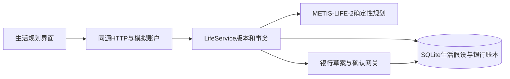

# TROPOS 2.0：生活与流动性

交付版本：2.0.0；日期：2026-10-22。运行 `./scripts/run.sh`，打开 `http://127.0.0.1:8765/demo.html`，进入“生活规划”。

## 这次交付什么

用户把工作、健康、家庭、搬家、购物、出行、教育和额外生活支出放在同一张现金日历中，自行声明金额、时间窗口、重要性及是否接受替代或暂不安排。系统对同一份合成账本给出三种安排，并在收入延期、突发支出及两者同时发生时检验现金路径。

- 保持原安排：使用用户首选金额和日期。
- 缓冲优先：在用户已允许的选项内选择更低支出、更晚日期，可能改变更多生活安排。
- 兼顾生活与现金：先减少支付缺口与现金底线缺口，再减少对生活安排的调整。

比较是假设；采用方案才会登记未来待付事项，登记仍不扣款。目标储蓄另行生成银行沙箱草案，执行前逐笔确认。

## 经济机制及其边界

### 流动性而非资产标签

当前主账户现金、隔离目标资金和不动用资产分别显示。不动用资产即使很大，也不会成为近期支付能力。未提供完整负债本金与资产变现成本，因此界面不宣称计算了完整净资产或真实可借额度。

### 有限期、可核验的现金约束

从合成账本基准日 2026-10-20 起，观察今天和未来30天。现有必要账单、有效订阅和日常预算照原输入计入；工资只是预计收入，实际到账前不增加当前可支付余额。收入延期通过移除原预计到账、在新日期加入同一笔收入实现，不重复计薪。

四个压力情景分别为当前预测、用户设置的额外收入延迟、额外一次支出、两者同时发生。它们是压力假设，没有估计概率。按日净额计算，不模拟同日扣款与收入的先后顺序，也不推出30天之外的结论。

### 有限离散选择，不冒充估计效用

每个场景只能在用户允许的日期范围内调整；金额只能保留原值、使用用户主动允许的明确替代金额，或在用户明确允许且非必要场景时暂不安排。必要支出不能自动取消。

兼顾方案使用宽度128的有限离散搜索，候选日期包括首选日、最晚日及范围内的预计工资后日期。排序依次比较最大支付缺口、最大现金底线缺口、生活调整分、缺口面积和日期。原安排与缓冲方案始终作为候选保留，避免剪枝后比两种基线都差；不保证全局最优。

生活调整分使用必要100、重要30、可调整5的演示权重，对改期、替代和暂不安排计分。它用于解释排序，不是估计的效用、货币福利或对用户偏好的结构估计。用户可更正重要性，不能由职业、年龄等身份标签替代。

### 机会成本的显示

每个方案同时显示生活支出、调整程度、现金不足、现金底线缺口、可讨论目标转入额和暂缓目标金额。额外现金缓冲敏感性固定同一套生活选择与拟目标金额，只改变假设的初始现金；不会修改余额或底线。

工资可承受额外延迟以无额外突发费用、目标尚未划转的兼顾安排检验。达到30天时只是测试上界；本期工资已到账时不再虚构对这笔工资的延期测试。

以上设计借鉴家庭流动性约束与缓冲储蓄思想，没有实现完整生命周期模型、HANK、收益预测或真实福利估计。理论背景可参阅 [Carroll 的缓冲储蓄研究](https://www.econ2.jhu.edu/people/ccarroll/papers/BufferStockTheory/BufferStockTheory.html) 与 [Wealthy Hand-to-Mouth](https://violante.economics.princeton.edu/publications/wealthy-hand-mouth)。

## 前后端结构

- `assets/life-ui.js/css`：生活表单、方案选择、四压力情景、SVG现金路径和敏感性。
- `assets/demo.js`：与原工作台共享账户、忙锁、画像、账本和逐笔确认入口。
- `backend/life_planner.py`：整数分计算、情景路径、候选搜索、解释和假设。
- `backend/life_service.py`：用户隔离、生活版本、读取同意、原子采用、幂等凭证、原子目标草案。
- `backend/service.py`：银行复式账本和账户版本；生活目标草案确认时同时复核生活版本。

## 状态与授权

1. 保存生活假设：只保存假设并增加生活版本，实际余额与银行账单不变。
2. 比较：只读取同一快照，不写交易或银行义务。
3. 采用方案：用户逐项核对并确认；服务端在同一事务中重新计算所选方案，按服务端金额和日期登记未来账单；用户允许放弃的假设标为取消。客户端不能提交任意分配金额。
4. 版本变化：银行账户版本增加，旧转账需重新核验；生活设置或假设变化也会让旧生活目标草案失效。
5. 目标草案：客户端提交用户看到的那份分析中的生活版本和银行版本；服务端同一写事务核对版本、无待比较假设和当前压力测试可行金额，再创建草案。其他标签页即使先增加再取消场景，生活版本仍会变化，旧分析不能继续生成草案；执行仍用原银行逐笔确认与幂等链路。
6. 重试与重置：同一采用凭证返回原登记结果，不重复加账单；重置只清当前合成账户的银行与生活状态。

已登记场景只通过银行现金路径计一次；不会又作为新假设扣除。场景登记不是商户支付，不能作为真实付款或银行确认凭证。

## DS 的实际参与

本轮真实调用了用户配置的 DeepSeek：

- 场景目录：DeepSeek Flash 生成八类初稿，审查后保留为目录。
- 生活界面：DeepSeek Pro 生成组件和样式骨架，集成时修正账户字段、版本、权限和失效状态。
- 常规后端：DeepSeek Pro 提供CRUD骨架与边界建议；后端实现及测试校正了同意、版本、事务与幂等问题。

核心经济机制、整数分路径、有限搜索、银行授权和集成由主架构方设计与审核。DS原始回包、采纳记录保留在本机 `.local/`；交付记录仅发布模型、成功状态和文件指纹，不包含密钥。

## 核验与待验收

完整命令见README。规划器不变量、用户隔离、事务回滚、并发幂等、HTTP链路、账户版本、受控DOM交互均有自动化检查。生活评测使用30个已知合成输入、3方案、4压力情景，由独立整数分参考计算核对360条现金路径；这不是盲测、真实用户效果或模型准确率。

未完成真实浏览器视觉、窄屏点击与录像验收；未接真实银行、生产认证或云端共用账本。多轮自然语言更正仍沿用安全澄清；本轮重点是有结构输入的生活规划与执行闭环。
